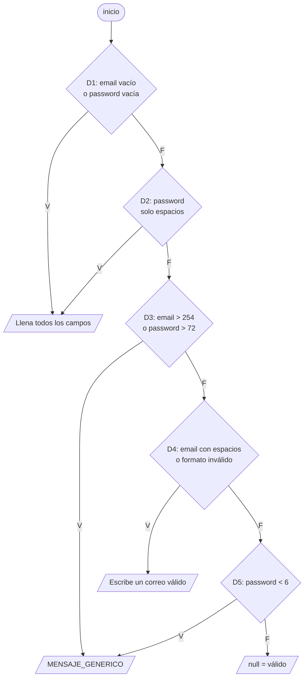
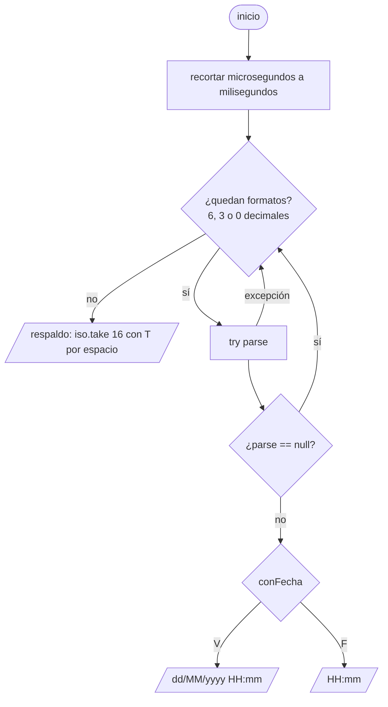
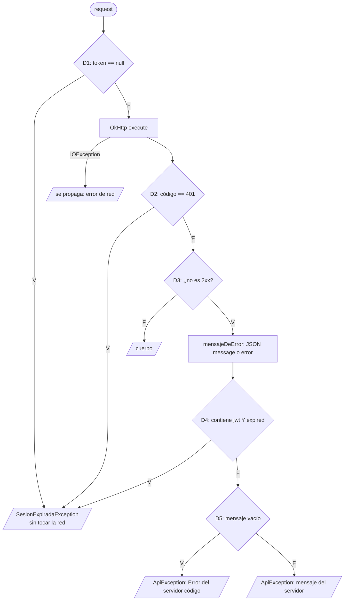

# Práctica 11: pruebas White Box de SEPPRO

**Alumno:** Armando Jaime Ramírez · **Matrícula:** 2022348004 · **Grupo:** IDGS14 · **Materia:** Aplicaciones Móviles

## 0. Datos de la ejecución

| Dato | Valor |
|---|---|
| Fecha y hora | 10/11/2026, de 20:34 a 21:00 (UTC-6, Querétaro) |
| Versión del código | commit `3d8d6aa` (rama `main`) + archivos de prueba de esta práctica |
| App evaluada | `seppro-movil` 1.0 (versionCode 1), paquete `com.seppro.movil`, minSdk 26 / targetSdk 34 |
| Dispositivo | Emulador Android Studio **Pixel 8a**, Android 16 (`sdk_gphone16k_x86_64`), GPU emulada **SwiftShader** |
| Equipo cliente | Windows 11 Home 10.0.26200 · Node.js v25.6.1 · curl 8.11.0 · JDK 17.0.11 (el de Android Studio) |
| Servidor | Supabase (PostgreSQL + PostgREST + Auth + Realtime + Storage), proyecto `sbhkqjueesxsjkfootuq`, detrás de Cloudflare (nodo **QRO**) |
| Red | Conexión doméstica Wi-Fi a Internet; el emulador usa la red del equipo |
| Datos | Cuentas y datos de prueba (`supabase-usuarios-prueba.sql`, `supabase-datos-prueba.sql`); sin datos reales de clientes |

**Herramientas:** Git, Android Lint, JUnit 4 + MockWebServer, JaCoCo 0.8.12, npm audit / npm outdated, curl, ping (ICMP de Windows), scripts de Node.js para la API y la carga (en lugar de k6 o JMeter, que no están instalados), ADB (`uiautomator`, `dumpsys gfxinfo`, `dumpsys meminfo`, modo avión) y Logcat.

**Código de las pruebas y evidencias:**

| Ruta | Contenido |
|---|---|
| `seppro-movil/app/src/test/java/com/seppro/movil/` | `ValidacionLoginTest.kt`, `ProcesamientoTest.kt` y `ApiTest.kt` (49 pruebas) |
| `pruebas/api/whitebox-api.mjs` | Fases 3 y 4: 36 casos HTTP contra Supabase |
| `pruebas/red/latencia-http.sh` | Latencia HTTP desglosada con curl |
| `pruebas/red/transferencia-y-carga.mjs` | Transferencia, 10 solicitudes y carga controlada |
| `pruebas/red/emulador.sh` | Utilidades de ADB para la prueba de desconexión |
| `pruebas/db/whitebox-db.sql` | EXPLAIN ANALYZE e índices (se ejecuta en el SQL Editor) |
| `pruebas/db/correcciones-propuestas.sql` | Correcciones de la Fase 6 |
| `pruebas/evidencias/` | Salidas reales: lint, cobertura, JSON/CSV, ping, gfxinfo y capturas |

**Cómo repetir las pruebas** (desde la raíz del repositorio):

```bash
# Pruebas unitarias y cobertura (JDK 17 de Android Studio)
JAVA_HOME="C:/Program Files/Android/Android Studio/jbr" ./seppro-movil/gradlew.bat -p seppro-movil :app:testDebugUnitTest :app:createDebugUnitTestCoverageReport
node pruebas/cobertura-resumen.mjs

# API, base de datos, red y carga
SEPPRO_PASS=<contraseña de prueba> node pruebas/api/whitebox-api.mjs
SEPPRO_PASS=<contraseña de prueba> bash pruebas/red/latencia-http.sh
SEPPRO_PASS=<contraseña de prueba> node pruebas/red/transferencia-y-carga.mjs
ping -n 20 sbhkqjueesxsjkfootuq.supabase.co
```

---

## Fase 1: inspección y análisis estático

### 1.1 Módulos principales

| Componente | Módulos |
|---|---|
| App del teléfono (`seppro-movil`) | `LoginActivity`, `MainActivity` (Toolbar + barra inferior), `PedidosFragment`, `HistorialFragment`, `VerificarFragment` + `BleScanner` (Bluetooth), `SoporteFragment`, `NuevoReporteActivity`, `ReporteActivity` (chat), `RealtimeCanal` (WebSocket), `ValidacionLogin`, `Estados`/`Ui` (vista) |
| Conexión con el servidor | `Api.kt` (OkHttp: `request`, `get`, `post`, `patch`, `rpc`, `subir`), `PedidosApi.obtenerPedidos`, `SoporteApi.*` (reportes, mensajes, Storage y URL firmada), `RealtimeCanal` (Realtime), `LoginActivity.performLogin` y `recuperarAcceso` (Auth con `HttpURLConnection`), `Presencia` (latido) |
| Acceso a la base de datos | No hay SQL en la app: todo pasa por la API REST de PostgREST, protegida con RLS y triggers (`supabase-soporte.sql`). Los filtros se arman con valores numéricos o UUID que vienen del servidor (`id=eq.$id`, `usuario_id=eq.$uid`). |
| App del reloj (`seppro-wearos`) | `LoginActivity` y `MainActivity` (`HttpURLConnection`) |
| Web (`seppro-angular`) | `supabase.service.ts` (`@supabase/supabase-js`), componentes standalone |

### 1.2 Herramientas de análisis estático

**Android Lint** (`gradlew :app:lintDebug`), con los reportes en `pruebas/evidencias/lint-*.txt`:

| App | Errores | Advertencias | Detalle |
|---|---|---|---|
| Teléfono | **0** | **57** | 50× `SetTextI18n` (texto armado en código, sin `strings.xml`), 4× `GradleDependency` (core-ktx 1.13.1 → 1.19.1, etc.), 2× `RedundantLabel` (manifiesto) y 1× `OldTargetApi` (targetSdk 34) |
| Reloj | **3** | **25** | **Errores:** 2× `WearPasswordInput` (`LoginActivity.kt:70`: Wear OS desaconseja pedir contraseña en el reloj) y 1× `WearStandaloneAppFlag` (falta el meta-data `standalone` en el manifiesto). **Advertencias:** 15× `SetTextI18n`, 6× `GradleDependency`, 2× `WearRecents`, 1× `OldTargetApi` y 1× `RedundantLabel` |

**npm audit (web): 76 vulnerabilidades en dependencias** (4 críticas, 30 altas, 35 moderadas y 7 bajas).
- La mayoría están en herramientas de compilación y del servidor de desarrollo (`webpack-dev-server`, `tar`, `shell-quote`, `piscina`, etc.), que no llegan al navegador del cliente.
- Sí afectan al código que se publica: `@angular/core` y `@angular/compiler` (XSS en i18n), `@angular/common` (fuga del token XSRF) y `@angular/service-worker` (filtración de cabeceras).

**npm outdated:** Angular 18.2.14 frente a la versión actual 21.2.x, `@supabase/supabase-js` 2.112.2 frente a 2.119.0 y TypeScript 5.5.4 frente a 7.0.2.

### 1.3 Revisión manual (puntos obligatorios)

| Punto de revisión | Resultado | Ubicación |
|---|---|---|
| Métodos sin manejo de excepciones | Todas las llamadas de red de la app del teléfono están en `try/catch` y distinguen `SesionExpiradaException`, `ApiException` y el error de red. **En el reloj:** sin `connectTimeout`/`readTimeout` (puede quedarse en "Cargando" para siempre) y sin manejo del código 401. | `seppro-wearos/.../MainActivity.kt:71-77` |
| Credenciales o claves expuestas | La `ANON_KEY` está en el código de las 3 apps. Es pública por diseño de Supabase y la seguridad depende de RLS (ver **DEF-01**). **La contraseña de las cuentas de prueba (incluido el admin) está en el repositorio** (ver **DEF-02**). No hay `service_role` en el código. | `SupabaseClient.kt:6`, `environment.ts:4`, `supabase-usuarios-prueba.sql:25` |
| Validaciones duplicadas o inexistentes | `ValidacionLogin` está copiado en el teléfono y en el reloj; las copias ya difieren (el reloj sigue usando `android.util.Patterns`). La doble validación cliente + servidor (CHECK y triggers) es intencional (defensa en profundidad). | `seppro-movil/.../ValidacionLogin.kt`, `seppro-wearos/.../ValidacionLogin.kt` |
| Código inaccesible o redundante | `Api.enc()` no se usa (JaCoCo: 0 % de cobertura y sin referencias). La función SQL `is_agente()` no se usa en ninguna política. | `Api.kt:53`, `supabase-soporte.sql:27` |
| Consultas construidas con datos sin validar | No hay SQL dinámico en la app: los filtros llevan números o UUID del servidor y PostgREST parametriza. En SQL, los triggers usan parámetros, no `EXECUTE` con concatenación. **Riesgo de inyección SQL: no se encontró.** | `SoporteApi.kt`, `PedidosApi.kt` |
| Red en el hilo principal | Ninguna: todo pasa en `thread { }` y vuelve con `runOnUiThread`, y el WebSocket usa los hilos de OkHttp. Ver el resultado de WB-06. | todos los `*Api.kt` y las Activities |
| Recursos que no se liberan | **El reloj** no llama a `conn.disconnect()`. En el teléfono, `LoginActivity` no desconecta si hay una excepción (desconecta solo en el camino normal). Los `thread {}` no se cancelan al cerrar la pantalla; se mitiga con `isFinishing` o `context ?: return`. El WebSocket se cierra en `onStop` y el escaneo BLE en `onPause`. | `wearos/MainActivity.kt:72`, `movil/LoginActivity.kt:156-214` |
| Sesión | El JWT dura 3600 s y no se usa el `refresh_token`: después de una hora, la app manda al usuario al login (DEF-09). | `LoginActivity.kt`, `Api.kt` |

---

## Fase 2: White Box de la app móvil

Se eligieron tres métodos críticos, más dos auxiliares de procesamiento:

| Tipo | Método | Archivo |
|---|---|---|
| Validación | `ValidacionLogin.validar(email, password)` | `ValidacionLogin.kt:35` |
| Procesamiento / cálculo | `SoporteApi.horaLocal(iso, conFecha)` y `RealtimeCanal.esperaReintento(intento)` | `SoporteApi.kt:198`, `RealtimeCanal.kt:157` |
| Comunicación con el servicio | `Api.request()` (usado por `get`, `post`, `patch`, `rpc` y `subir`) y `Api.mensajeDeError()` | `Api.kt:56`, `Api.kt:75` |

Para poder ejecutarlos en la JVM se hicieron dos cambios que no alteran el comportamiento:
- El patrón de correo se escribió en Kotlin puro en lugar de usar `android.util.Patterns`.
- `Api.baseUrl` se volvió configurable para usar un servidor simulado (MockWebServer).

### 2.1 Método de validación: `ValidacionLogin.validar`

```kotlin
fun validar(email: String, password: String): String? = when {
    email.isEmpty() || password.isEmpty()                      -> "Llena todos los campos"     // D1 (C1a, C1b)
    password.isBlank()                                         -> "Llena todos los campos"     // D2
    email.length > 254 || password.length > 72                 -> MENSAJE_GENERICO             // D3 (C3a, C3b)
    email.any { it.isWhitespace() } || !correoValido(email)    -> "Escribe un correo válido"   // D4 (C4a, C4b)
    password.length < 6                                        -> MENSAJE_GENERICO             // D5
    else                                                       -> null                         // válido
}
```

**Grafo de flujo de control:**



- **Complejidad ciclomática:** V(G) = 5 decisiones + 1 = **6** (contando cada condición simple: 11, que es lo que reporta JaCoCo).
- **Caminos independientes:**
  - P1: D1 = V
  - P2: D1 = F, D2 = V
  - P3: D1–D2 = F, D3 = V
  - P4: D1–D3 = F, D4 = V
  - P5: D1–D4 = F, D5 = V
  - P6: todas F → válido

**Casos de prueba** (`ValidacionLoginTest.kt`, 17 pruebas):

| Camino / técnica | Entrada | Esperado | Obtenido |
|---|---|---|---|
| P1 (C1a=V) | `""`, `123456` | "Llena todos los campos" | ✅ |
| P1 (C1a=F, C1b=V) | correo válido, `""` | "Llena todos los campos" | ✅ |
| P2 | correo válido, `"      "` | "Llena todos los campos" | ✅ |
| P3 (C3a=V), límite 255 | correo de 255 caracteres | genérico | ✅ |
| P3 (C3a=F, C3b=V), límite 73 | contraseña de 73 | genérico | ✅ |
| P4 (C4a=V) | `ana @seppro.com` | "Escribe un correo válido" | ✅ |
| P4 (C4a=F, C4b=V) | `abc`, `ana@seppro` | "Escribe un correo válido" | ✅ |
| P5, límite 5 | contraseña `12345` | genérico | ✅ |
| P6 | `cliente1@seppro.com`, `123456` | `null` | ✅ |
| Valor límite válido | contraseña de 6 y de 72; correo de 254 | `null` | ✅ |
| Seguridad | `ana@seppro.com' OR '1'='1` | correo inválido | ✅ |

**Cobertura de condiciones** (cada condición simple toma los valores V y F):

| Condición | V | F |
|---|---|---|
| C1a `email.isEmpty()` | `p1a` | `p1b` |
| C1b `password.isEmpty()` | `p1b` | `p2` |
| C2 `password.isBlank()` | `p2` | `p6` |
| C3a `email.length > 254` | `p3a` | `p3b` |
| C3b `password.length > 72` | `p3b` | `p6` |
| C4a espacios en el correo | `p4a` | `p4b` |
| C4b formato inválido | `p4b` | `p6` |
| C5 `password.length < 6` | `p5` | `p6` |

**JaCoCo:** instrucciones **100 % (63/63)**, ramas **100 % (20/20)**, líneas 100 % (9/9).

### 2.2 Métodos de procesamiento: `SoporteApi.horaLocal` y `RealtimeCanal.esperaReintento`

**`horaLocal`** convierte la fecha del servidor (`2026-11-10T18:04:05.123456+00:00`) a la hora local del teléfono:



- **V(G) = 4.**
- **Casos (8):**
  - con micro, mili y sin decimales (este último recorre el ciclo hasta el tercer formato)
  - `conFecha` = V
  - cambio de día al convertir a UTC-6
  - texto inválido, fecha sin zona y cadena vacía (respaldo)
- **JaCoCo:** instrucciones **97.5 % (78/80)**, ramas **83.3 % (5/6)**.
- **Rama no cubierta y su justificación:** `parse() == null` no ocurre, porque `SimpleDateFormat.parse(String)` lanza `ParseException` en lugar de devolver `null`. Es código defensivo; forzar esa rama requeriría una prueba artificial.

**`esperaReintento`** calcula la espera exponencial de la reconexión de Realtime: `min(2000 · 2^min(n−1, 4), 30000)` ms.
- **V(G) = 2.**
- **Valores límite:** −3, 0, 1, 2, 3, 4, 5 (32 000 → tope de 30 000), 6 y 10 000 (sin desbordamiento).
- **Cobertura:** 100 % de instrucciones y 100 % de ramas.

**Conversión de JSON** (`Reporte.desdeJson`, `Mensaje.desdeJson`):
- **Qué se prueba:** que un `null` del servidor no se convierta en el texto `"null"`, los valores por defecto y la excepción si falta `id`.
- **Cobertura:** 100 % de instrucciones y 100 % de ramas en los dos métodos.

### 2.3 Método de comunicación: `Api.request` + `Api.mensajeDeError`



**Casos** (`ApiTest.kt`, 16 pruebas con MockWebServer):

| Caso | Camino | Resultado |
|---|---|---|
| Sin token | D1 = V; se comprueba que **no** hubo petición (`requestCount = 0`) | ✅ |
| GET 200 | Devuelve el cuerpo y envía `apikey` + `Bearer` | ✅ |
| POST 201 | Envía el cuerpo y el Content-Type JSON | ✅ |
| PATCH | Método PATCH + `Prefer: return=representation` | ✅ |
| `rpc("latido")` | Llama a `/rest/v1/rpc/latido` y maneja el 204 sin cuerpo | ✅ |
| `subir` | 1024 bytes, `x-upsert: false` | ✅ |
| 401 | `SesionExpiradaException` | ✅ |
| 403 del trigger | `ApiException(403, "Solo el administrador…")` | ✅ |
| 400 `{"error":…}` | Usa el campo `error` | ✅ |
| 500 con HTML / 404 `{}` | Mensaje genérico "Error del servidor (código)" | ✅ |
| D4: C4a=V, C4b=V | `jwt expired` → sesión expirada | ✅ |
| D4: C4a=V, C4b=F | `invalid jwt signature` → ApiException | ✅ |
| D4: C4a=F, C4b=V | `token expired for coupon` → ApiException 409 | ✅ |
| Servidor caído | `IOException`, que **no** se confunde con `ApiException` | ✅ |
| Corte a mitad de la respuesta | `IOException` | ✅ |

**JaCoCo:**
- `request`: instrucciones **96.4 % (106/110)**, ramas **80 % (8/10)**. Lo no cubierto es `resp.body?.` = `null`, que OkHttp nunca devuelve en `execute()`.
- `mensajeDeError`: **100 % / 100 %**.

### 2.4 Resultado de cobertura (JaCoCo 0.8.12)

**49 pruebas · 0 fallas · 0 errores · 1.53 s** (`pruebas/evidencias/cobertura-jacoco.txt`).

| Alcance | Instrucciones | Ramas | Objetivo |
|---|---|---|---|
| Módulos críticos (`ValidacionLogin`, `Api`, `RealtimeCanal.Companion`, `Reporte`, `Mensaje`) | **97.5 % (688/706)** | **97.0 % (64/66)** | ≥ 85 % / ≥ 80 % ✅ |
| Toda la app (incluye pantallas) | 7.5 % (1 009/13 434) | 9.2 % (72/781) | No aplica |

La cobertura global es baja a propósito: las Activities y los Fragments construyen la interfaz y dependen de Android, así que se probaron en el emulador (WB-06 y NET-05/06) y no con pruebas JVM artificiales. En `Api`, lo único sin cubrir (el 5.3 % que falta) es `Api.enc()`, que es **código muerto** según la revisión de la Fase 1.

---

## Fase 3: White Box del sitio web y los servicios (API)

El backend de la web y de las apps es la API de Supabase: PostgREST para las tablas y las RPC, y Auth.
- **Lógica revisada en el servidor:** políticas RLS, CHECK, triggers `reportes_al_crear`, `reportes_al_editar` y `mensajes_al_crear`, y funciones RPC (`supabase-soporte.sql`).
- **Lógica revisada en el cliente web:** `supabase.service.ts`.

**Ejecución:** `node pruebas/api/whitebox-api.mjs`. **Resultado: 36/36 casos con el código HTTP esperado** (`pruebas/evidencias/api-whitebox.json`).

| Código | Caso real (ID) | Endpoint | Obtenido | ms |
|---|---|---|---|---|
| **200** | Login válido (WEB-01a) | `POST /auth/v1/token` | 200 · `expires_in=3600` · la respuesta no incluye la contraseña | 831 |
| **200** | Pedidos del cliente (WEB-01b) | `GET /rest/v1/pedidos?select=*,pedido_items(*)` | 200 · 9 filas · estructura consistente y solo pedidos propios | 194 |
| **201** | Insertar reporte (DB-01) | `POST /rest/v1/reportes` | 201 · el servidor asignó folio, cliente y prioridad | 180 |
| **204** | Quitar del carrito (DB-05a) / latido (WEB-01c) | `DELETE /rest/v1/carrito`, `POST /rpc/latido` | 204 sin cuerpo | 161 / 211 |
| **400** | Contraseña incorrecta (WEB-02a) | `POST /auth/v1/token` | 400 "Invalid login credentials" | 186 |
| **400** | JSON mal formado (WEB-02b) | `POST /auth/v1/token` | 400 "Could not parse request body as JSON" | 347 |
| **400** | Mensaje de solo espacios (WEB-03b) | `POST /rest/v1/mensajes` | 400 · `23514` violación de CHECK | 188 |
| **401** | Token inválido (WEB-04a) | `GET /rest/v1/pedidos` | 401 · `PGRST301` | 174 |
| **401** | RPC de admin **sin sesión** (WEB-04b) | `POST /rpc/agentes_estado` | 401 | 202 |
| **403** | RPC de admin **con sesión de cliente** (WEB-04c) | `POST /rpc/agentes_estado` | 403 · `42501` | 205 |
| **403** | Cliente2 escribe en un reporte ajeno (WEB-04f) | `POST /rest/v1/mensajes` | 403 · violación de RLS | 183 |
| **404** | Tabla inexistente (WEB-02c) | `GET /rest/v1/tabla_que_no_existe` | 404 · `PGRST205` | 193 |
| **406** | Un solo registro inexistente (WEB-02d) | `GET /reportes?id=eq.999999` con `Accept: …object+json` | 406 · `PGRST116` | 168 |
| **409** | Producto repetido en el carrito (DB-02g) | `POST /rest/v1/carrito` | 409 · `23505` UNIQUE | 186 |
| **422** | Registro con contraseña débil (WEB-03a) | `POST /auth/v1/signup` | 422 "Password should be at least 6 characters" | 198 |
| **500** | No se reprodujo | — | — | — |

**Conclusiones de esta fase:**
- **El servidor no responde siempre 200:** todas las operaciones inválidas se rechazaron con 4xx.
- **Distingue autenticación de autorización:**
  - la misma RPC responde **401** sin sesión (WEB-04b) y **403** con sesión sin permiso (WEB-04c)
  - un token inválido da 401 (WEB-04a)
- **Para "no encontrado", PostgREST responde 200 con `[]`** en las listas (DB-03b), y 404 solo cuando la tabla no existe. Para pedir un solo registro existe 406. La app lo maneja: `SoporteApi.reporte()` interpreta `[]` como `null` y muestra "Ya no tienes acceso a este reporte".
- **Un DELETE sin permiso no da error:** responde 200 o 204 con **0 filas** (DB-05b), porque RLS filtra en silencio. La app no borra reportes, pero cualquier cliente que lo haga debe revisar las filas afectadas (DEF-08).
- **500:** no se puede provocar sin modificar el servidor. Los errores de la base de datos (CHECK, RLS, triggers) se traducen a 4xx. Como alternativa, se probó en `ApiTest.respuesta500_cuerpoNoJson_mensajeGenerico` que la app maneja un 500 con cuerpo HTML.
- **Datos sensibles:** el login no devuelve la contraseña ni su hash, y los mensajes de error no revelan si falló el usuario o la contraseña. **Pero** `GET /rest/v1/perfiles` **sin sesión devolvió 200 con los correos y roles de los 12 usuarios** (WEB-05s, **DEF-01**).

---

## Fase 4: White Box de la base de datos

Las operaciones se ejecutaron por la API, con la sesión de cada rol, para que pasen por RLS y los triggers como en la app real (`whitebox-api.mjs`).

| # | Operación | Caso | Resultado observado |
|---|---|---|---|
| 1 | Inserción válida | DB-01 | 201 · folio `REP008` · `cliente_id` forzado al usuario de la sesión · la prioridad pasó de `baja` a **`alta`** porque el pedido tenía daño (trigger) |
| 2 | Inserción inválida | DB-02a…e | 400 CHECK (descripción < 10, tipo inválido, prioridad numérica) · 400 `23502` NOT NULL (sin `tipo`) · **403** con el pedido de otro cliente (trigger antes de la FK) |
| 3 | Consulta por id existente | DB-03a | 200 · 1 fila |
| 4 | Consulta por id inexistente | DB-03b / WEB-02d | 200 `[]` · 406 si se pide un solo objeto |
| 5 | Actualización | DB-04a | 200 con la fila actualizada · `updated_at` lo pone el trigger |
| 6 | Eliminación | DB-05a/c/d | Carrito 204 · admin borra el reporte (1 fila) · sus mensajes se borran en **cascada** (0 restantes) |
| 7 | Consulta después de la operación | DB-04b | **persistió = true** |
| 8 | Dos operaciones concurrentes | DB-06 | Dos PATCH simultáneos: **A = 200 y B = 200**. Valor final: "Escritura A / baja". Una de las dos escrituras se perdió **sin aviso** (*lost update*, **DEF-04**) |
| — | Restricciones | DB-02f/g | UNIQUE (usuario, producto) del carrito → **409** |
| — | Seguridad | DB-03c, WEB-04f, DB-04c | Cliente2 no ve ni escribe en el reporte de cliente1; un cliente no puede reasignar (403 del trigger) |
| — | Reintento | NET-06d | El mismo mensaje enviado 2 veces → **2 filas** (no es idempotente, **DEF-03**) |
| — | Huecos en los folios | — | Los INSERT rechazados consumen la secuencia: después de REP008 siguió REP014. Es normal en PostgreSQL; el folio no debe tomarse como consecutivo sin huecos. |

**Revisión del esquema:**
- **Índices existentes** (definidos en los scripts):
  - llaves primarias
  - `reportes(cliente_id)`, `reportes(agente_id)` y `mensajes(reporte_id, id)`
  - UNIQUE de `carrito` y `lista_deseos`
- **Índices que faltan:** `pedidos(usuario_id)` y `pedido_items(pedido_id)`, que son justo los filtros de la consulta más usada (Mis pedidos en la web, el teléfono y el reloj). PostgreSQL no crea índices para las llaves foráneas (**DEF-07**).
- **Transacciones:** cada petición de PostgREST es una transacción. `pruebas/db/whitebox-db.sql` comprueba la atomicidad: un INSERT válido seguido de uno inválido dentro de la misma transacción → se revierten los dos.
- **Consultas que traen más de lo necesario:**
  - el reloj pide `pedidos?select=*,pedido_items(*)` **sin filtrar por usuario ni limitar columnas**
  - la app trae `select=*`, aunque solo usa id, total, estado y productos (4 845 bytes para 9 pedidos)

**Tiempo de consulta con EXPLAIN ANALYZE.** Se mide en la base de datos con `pruebas/db/whitebox-db.sql` (Supabase > SQL Editor):
- Q1: pedidos sin RLS
- Q2: la misma consulta con RLS como cliente1
- Q3: mensajes del chat con RLS
- Q4: reportes del administrador

Salida real en `pruebas/evidencias/explain-analyze.txt`:

| Consulta | Execution Time | Planning Time | Filas | Tipo de escaneo | Observación |
|---|---|---|---|---|---|
| Q1: pedidos + productos de cliente1 (sin RLS) | **2.133 ms** | 2.575 ms | 10 | **Seq Scan** en `pedidos` (usuario_id) y en `pedido_items` (pedido_id, 10 veces); Seq Scan en `perfiles` por email | Sin índice: descarta 9 pedidos y 19 productos por cada búsqueda |
| Q2: la misma consulta **con RLS** como cliente1 (lo que hace la app) | **1.813 ms** | 0.763 ms | 10 | Seq Scan en `pedidos` y `pedido_items` con filtro `auth.uid() = usuario_id OR is_admin()`; Index Scan en `pedidos_pkey` dentro de la política de `pedido_items` | El planificador **estima un costo de 15 748** (contra 34 sin RLS), porque cuenta las funciones `is_admin()` y `EXISTS` por fila. Hoy no se nota (1.8 ms), pero crece con los datos |
| Q3: mensajes de REP002 con RLS (chat) | **0.724 ms** | 2.552 ms | 5 | **Index Scan** con `mensajes_reporte_idx` + filtro `puede_ver_reporte()`; Seq Scan en `reportes` por folio | El índice del chat sí se usa ✅ |
| Q4: reportes del admin con RLS | **1.323 ms** | 0.509 ms | 6 | Nested Loop + **Index Scan** con `reportes_cliente_idx`, Hash Join para el agente | Usa los índices creados en `supabase-soporte.sql` ✅ |

**Conclusiones:**
- Las 4 consultas tardan entre **0.7 y 2.1 ms** dentro de la base de datos, muy por debajo del objetivo de 200 ms.
- Desde la app, la misma información tarda **213 ms** con conexión reutilizada y **423 ms** con conexión nueva, así que **más del 99 % del tiempo está fuera de la consulta** (red, TLS y PostgREST).
- El plan **confirma DEF-07**: `pedidos` y `pedido_items` se leen completas (Seq Scan) por falta de índice en `usuario_id` y `pedido_id`.
- Con 19 pedidos no importa, pero el costo crece de forma lineal con el número de pedidos de **todos** los clientes.

**Atomicidad (DB-TX):** en una misma transacción se hizo un INSERT válido y luego uno que viola el CHECK de la descripción. Resultado real:

```
ERROR:  P0001: RESULTADO -> reportes antes=6, después=6 (se revirtió TODO)
```

El reporte válido **tampoco** quedó guardado: PostgreSQL revierte el bloque completo y no deja operaciones a medias. El mensaje sale como error a propósito: el `RAISE` final muestra el conteo y deshace todo para no ensuciar los datos.

---|---|---|---|
> | Q1 | | | |
> | Q2 | | | |
> | Q3 | | | |
> | Q4 | | | |
> | Atomicidad | — | — | |

---

## Fase 5: conectividad y rendimiento

### A. Ping (ICMP), 20 paquetes a `sbhkqjueesxsjkfootuq.supabase.co`

| Métrica | Valor |
|---|---|
| IP que respondió | 104.18.38.10 (**Cloudflare**, no el servidor de base de datos) |
| Mínimo / Promedio / Máximo | **61 / 72.8 / 81 ms** |
| Desviación estándar / variación (máx − mín) | **5.3 ms / 20 ms** |
| Paquetes perdidos | **0 de 20 (0 %)** |

**Limitación:** el ping mide la ida y vuelta hasta el borde de Cloudflare, no hasta PostgreSQL, y no incluye TLS ni el procesamiento de la API. Por eso no se compara directamente con la latencia HTTP.

### B. Latencia HTTP: `GET /rest/v1/pedidos?select=*,pedido_items(*)` (cliente1)

**Diez solicitudes con conexión nueva cada vez** (curl, `pruebas/evidencias/latencia-http.csv`):

| Solicitud | Código HTTP | Tiempo (ms) | Tamaño (bytes) |
|---|---|---|---|
| 1 | 200 | 485.3 | 4 845 |
| 2 | 200 | 479.0 | 4 845 |
| 3 | 200 | 451.7 | 4 845 |
| 4 | 200 | 368.8 | 4 845 |
| 5 | 200 | 326.9 | 4 845 |
| 6 | 200 | 456.0 | 4 845 |
| 7 | 200 | 348.7 | 4 845 |
| 8 | 200 | 333.5 | 4 845 |
| 9 | 200 | 454.1 | 4 845 |
| 10 | 200 | 527.6 | 4 845 |
| **Mín / Prom / Máx** | **10/10 con 200** | **326.9 / 423.2 / 527.6** (DE 68.2) | **4 845 (4.7 KB), sin variación** |

**Desglose promedio** (tiempos acumulados de curl, contados desde el inicio de la solicitud):

| Momento | ms |
|---|---|
| DNS resuelto | 12.8 |
| Conexión TCP lista | 83.7 |
| TLS listo | 179.4 |
| Primer byte | 421.2 |

La conexión (DNS + TCP + TLS) cuesta unos **179 ms**. El tiempo de servidor (primer byte − TLS) es **241.8 ms** en promedio.

**Diez solicitudes reutilizando la conexión (keep-alive)**, como hace OkHttp en la app:
- tiempos: 471.8, 301.6, 163.0, 150.8, 163.1, 170.9, 180.1, 201.8, 173.0 y 154.1 ms
- **mín 150.8 / prom 213.0 / máx 471.8 ms**

La primera solicitud paga la conexión TCP+TLS; las siguientes ahorran unos 180 ms.

### C. Tasa de transferencia (Storage, archivo de 1 MB = 1 048 576 bytes)

Fórmula: Tasa (Mbps) = (bytes × 8) / (tiempo en s × 1 000 000).

| Medición | Subida (s) | Subida (Mbps) | Descarga (s) | Descarga (Mbps) | Íntegro |
|---|---|---|---|---|---|
| 1 | 1.867 | 4.49 | 0.706 | 11.88 | ✅ |
| 2 | 1.539 | 5.45 | 0.717 | 11.69 | ✅ |
| 3 | 1.082 | 7.75 | 0.441 | 19.02 | ✅ |
| **Promedio** | **1.496** | **5.90** | **0.621** | **14.20** | 3/3 |

- **Íntegro** significa que el archivo descargado es idéntico byte por byte al que se subió.
- La descarga se hizo con una **URL firmada**; con un token alterado, el servidor la rechaza.

### D. Carga controlada (NET-07), 20 solicitudes por escenario

| Endpoint | Usuarios | Exitosas | Fallidas | Prom (ms) | P95 (ms) | Máx (ms) | Solicitudes/s | Mbps (respuesta) |
|---|---|---|---|---|---|---|---|---|
| GET pedidos (lectura) | 1 | 20 | 0 | 166.1 | 197.4 | 219.2 | 6.02 | 0.233 |
| GET pedidos | 5 | 20 | 0 | 229.4 | 428.5 | 440.6 | 19.74 | 0.765 |
| GET pedidos | 10 | 20 | 0 | 231.7 | 441.0 | 497.0 | 38.70 | 1.500 |
| POST mensajes (escritura) | 1 | 20 | 0 | 166.4 | 183.0 | 228.8 | 6.01 | — |
| POST mensajes | 5 | 20 | 0 | 191.1 | 295.7 | 309.1 | 24.28 | — |
| POST mensajes | 10 | 20 | 0 | 222.8 | 446.7 | 471.8 | 29.87 | — |

- **120/120 solicitudes exitosas.**
- **Consistencia:** después de la carga había exactamente **60 mensajes**, los esperados (sin pérdidas ni duplicados).
- **Comportamiento:** de 1 a 10 usuarios el rendimiento sube 6.4 veces (de 6 a 38.7 solicitudes/s), mientras que el promedio solo pasa de 166 a 232 ms y el P95 se duplica (de 197 a 441 ms). El servidor aún no se satura.
- **La columna Mbps es "—" en escritura:** las escrituras no devuelven cuerpo (`return=minimal`).
- **CPU y memoria del servidor:** no se pueden ver desde el cliente; se consultan en Supabase > Reports.
- **Limpieza:** el reporte temporal (REP014) se borró y sus mensajes se fueron en cascada.

### E. Prueba de interrupción (NET-05 / NET-06) en el emulador

**Pasos:** cliente1 → Soporte → REP002 → **modo avión activado** (`adb shell cmd connectivity airplane-mode enable`) → escribir y tocar Enviar.

| Criterio | Resultado | Evidencia |
|---|---|---|
| Detecta el error | Toast "No se pudo enviar el mensaje. Revisa tu conexión a Internet". En Logcat: `SEPPRO_Chat: No se pudo enviar el mensaje: UnknownHostException` | `net05-chat-sin-conexion.png` |
| No muestra la operación fallida como exitosa | El mensaje **no** aparece en el chat y el indicador cambia a "○ Conectando al chat en tiempo real…" | misma captura |
| Conserva los datos | El texto se queda en la caja para reenviarlo | misma captura |
| Reintenta de forma controlada | Reconexión de Realtime en Logcat a las 02:54:08 → :10 (+2 s) → :14 (+4 s) → :22 (+8 s) → :38 (+16 s). Es la espera exponencial de `esperaReintento` | Logcat `SEPPRO_Realtime` |
| Recupera la conexión | Al quitar el modo avión, el indicador volvió a "● En vivo" en unos 15 s y el reenvío funcionó | `net06-recuperacion.png` |
| No duplica registros | En la base de datos hay **1** solo mensaje "Prueba NET05 sin conexion" (id 82) | consulta REST |

**Riesgo detectado:** si la conexión se cae **después** de que el servidor guardó el mensaje pero **antes** de que llegue la respuesta, el usuario lo reenvía y queda duplicado. Esto se demostró en NET-06d (**DEF-03**).

### F. Rendimiento de interfaz (WB-06)

`dumpsys gfxinfo` mientras se desplaza la lista de pedidos 10 veces:

| App | Cuadros | Cuadros lentos | P50 | P90 | P95 | Principal causa |
|---|---|---|---|---|---|---|
| SEPPRO (lista de pedidos) | 215 | 91.6 % | 97 ms | 129 ms | 150 ms | "Slow issue draw commands" (197) |
| **Ajustes de Android (referencia)** | 100 | 93.0 % | 93 ms | 150 ms | — | "Slow issue draw commands" (93) |

**Interpretación:**
- El emulador dibuja con **SwiftShader**, una GPU por software, y hasta la app del sistema tiene 93 % de cuadros lentos.
- La lentitud viene del entorno, no de la app: SEPPRO queda en el mismo nivel que la referencia.
- **Alternativa válida:** repetir en un teléfono físico.
- **Memoria de la app:** PSS 75.6 MB, Java Heap 7.0 MB y Native Heap 11.6 MB (`meminfo-app.txt`).

---

## Fase 6: defectos, riesgos y mejoras

| ID | Componente | Severidad | Pasos para reproducir | Esperado | Observado | Evidencia | Corrección propuesta |
|---|---|---|---|---|---|---|---|
| **DEF-01** | BD / RLS (`supabase-schema.sql`, política `perfiles_own_read`) | **Crítica** | `GET /rest/v1/perfiles?select=email,rol` solo con la llave pública, sin sesión | 0 filas (o 401) | **200 con los correos y roles de los 12 usuarios** | WEB-05s | Política `TO authenticated` y solo el propio perfil, el admin o quien comparte un reporte (`pruebas/db/correcciones-propuestas.sql`) |
| **DEF-02** | Repositorio y cuentas (`supabase-usuarios-prueba.sql:25`) | **Alta** | Leer el script en GitHub e iniciar sesión como `admin@seppro.com` | Credenciales fuera del repositorio | La contraseña de prueba está publicada y **funciona en el proyecto real** (login del admin: 200) | WEB-01a, verificación inicial | Cambiar la contraseña del admin, leer las contraseñas de una variable al ejecutar el script y usar cuentas de prueba en un proyecto aparte |
| **DEF-03** | App + BD (`SoporteApi.enviarMensaje`, tabla `mensajes`) | Media | Enviar el mismo mensaje dos veces (reintento tras un corte) | 1 fila | **2 filas** | NET-06d | Que la app genere un UUID por mensaje (`id_cliente`) con índice UNIQUE; un reintento recibe 409 y no duplica |
| **DEF-04** | App + BD (`SoporteApi.actualizarReporte`) | Media | Dos PATCH simultáneos al mismo reporte | Conflicto detectado | Los dos dan 200 y una escritura se pierde | DB-06 | Bloqueo optimista: PATCH con `&updated_at=eq.<valor leído>`; si devuelve 0 filas, avisar "el reporte cambió, recarga" |
| **DEF-05** | Reloj (`wearos/MainActivity.kt:71-77`, manifiesto) | Media | Sin red estable, o con una cuenta admin en el reloj | Timeout y solo pedidos propios | Sin `connectTimeout`/`readTimeout`, sin `disconnect()`, sin filtro `usuario_id`, sin manejo de 401; Lint: 3 errores | Lint del reloj, revisión | Reutilizar `Api`/OkHttp con timeouts, filtrar `usuario_id=eq.<uid>`, agregar `standalone` al manifiesto e iniciar sesión desde el teléfono |
| **DEF-06** | BD (funciones RPC) | Baja | `POST /rpc/agentes_estado` sin sesión | Que la función ni se ejecute | 401, pero el mensaje viene **de dentro** de la función (se ejecutó para `anon`, porque `EXECUTE` se concede a PUBLIC) | WEB-04b | `REVOKE … FROM PUBLIC, anon` y `GRANT … TO authenticated` |
| **DEF-07** | BD (índices) | Media (crece con los datos) | EXPLAIN de Q1/Q2 | Index Scan | Sin índice en `pedidos.usuario_id` ni en `pedido_items.pedido_id`: **EXPLAIN confirma Seq Scan** en Q1 y Q2 (descarta 9 de 19 pedidos y 19 de 20 productos en cada búsqueda) y un costo estimado de 15 748 con RLS | `explain-analyze.txt` | `CREATE INDEX pedidos_usuario_fecha_idx …` y `pedido_items_pedido_idx` |
| **DEF-08** | API (PostgREST + RLS) | Baja | DELETE de un reporte con sesión de cliente | 403 | 200 con 0 filas, sin error | DB-05b | Usar `Prefer: return=representation` y validar el número de filas; o una política explícita que documente el rechazo |
| **DEF-09** | App (sesión) | Media (usabilidad) | Dejar la app abierta más de 1 hora | Renovar el token | `expires_in = 3600` y no se usa `refresh_token`: al vencer, la app manda al login | WEB-01a, revisión | Guardar el `refresh_token` cifrado (EncryptedSharedPreferences) y renovar ante un 401 |
| **DEF-10** | Web (dependencias) | Alta | `npm audit` | 0 vulnerabilidades de producción | 76 (4 críticas, 30 altas); Angular 18.2.14 con avisos de XSS, XSRF y service worker | npm audit | `npm audit fix` y actualizar Angular a la versión con parche |

---

## Matriz de pruebas White Box

| ID | Prueba | Resultado | Evidencia |
|---|---|---|---|
| WB-01 | Cobertura de instrucciones | **Aprobado:** 97.5 % en los módulos críticos (≥ 85 %) | `cobertura-jacoco.txt`, reporte HTML de JaCoCo |
| WB-02 | Cobertura de decisiones | **Aprobado:** 97.0 % de ramas en los módulos críticos (≥ 80 %); 2 ramas no alcanzables justificadas | idem |
| WB-03 | Cobertura de condiciones | **Aprobado:** cada condición de `validar` (8) y de `mensajeDeError` (C4a/C4b) tomó V y F | Tablas 2.1 y 2.3 |
| WB-04 | Manejo de excepciones | **Aprobado:** sin token, 401, 4xx, 500, servidor caído, corte a mitad de la respuesta y JSON sin id | `ApiTest`, `ProcesamientoTest` |
| WB-05 | Validación de entradas | **Aprobado:** 17 casos con valores límite (5/6/72/73 y 254/255) | `ValidacionLoginTest` |
| WB-06 | Rendimiento de interfaz | **No concluyente en el emulador:** 91.6 % de cuadros lentos, igual que la referencia del sistema (93 %), por SwiftShader. Memoria: PSS 75.6 MB | `gfxinfo-*.txt`, `meminfo-app.txt` |
| WEB-01 | Respuesta HTTP exitosa | **Aprobado:** 200, 201 y 204 | `api-whitebox.json` |
| WEB-02 | Respuesta HTTP de error | **Aprobado:** 400, 404, 406 y 409; el 500 no se puede reproducir (justificado) | idem |
| WEB-03 | Validación del backend | **Aprobado:** 422 de Auth y 400 por CHECK y NOT NULL | idem |
| WEB-04 | Autenticación y autorización | **Aprobado con defecto:** distingue 401 de 403; **DEF-01** (perfiles expuestos) | idem |
| WEB-05 | Latencia HTTP | **Aprobado:** 423 ms con conexión nueva y 213 ms con keep-alive (≤ 500 ms) | `latencia-http.csv` |
| WEB-06 | Consistencia de respuesta | **Aprobado:** 10/10 con 200, 4 845 bytes iguales y estructura JSON con las mismas llaves | idem |
| DB-01 | Inserción válida | **Aprobado:** 201 con valores puestos por el trigger | `api-whitebox.json` |
| DB-02 | Integridad | **Aprobado:** CHECK, NOT NULL, UNIQUE (409), dueño del pedido (403) y cascada | idem |
| DB-03 | Consulta | **Aprobado:** id existente, id inexistente y RLS entre clientes. EXPLAIN ANALYZE: Q1 2.133 ms, Q2 1.813 ms, Q3 0.724 ms y Q4 1.323 ms (≤ 200 ms) | `api-whitebox.json`, `explain-analyze.txt` |
| DB-04 | Actualización | **Aprobado:** persiste; el trigger bloquea reasignar (403) | idem |
| DB-05 | Eliminación | **Aprobado con observación:** 204 y cascada; un DELETE sin permiso responde 200 con 0 filas (DEF-08) | idem |
| DB-TX | Transacción / operaciones parciales | **Aprobado:** antes = 6 y después = 6; se revirtió todo, también el INSERT válido | `explain-analyze.txt` |
| DB-06 | Concurrencia | **Fallido:** pérdida de actualización sin aviso (DEF-04) | idem |
| NET-01 | Ping | **Aprobado:** 61/72.8/81 ms, DE 5.3, 0 % de pérdida | `ping-supabase.txt` |
| NET-02 | Latencia de API | **Aprobado:** promedio de 423.2 ms (nueva) y 213.0 ms (keep-alive) | `latencia-http.csv`, `transferencia-y-carga.json` |
| NET-03 | Tasa de descarga | **Medido:** 14.20 Mbps promedio (3 mediciones) | `transferencia-y-carga.json` |
| NET-04 | Tasa de subida | **Medido:** 5.90 Mbps promedio (3 mediciones) | idem |
| NET-05 | Pérdida de conexión | **Aprobado:** detecta, no muestra éxito falso y conserva el texto | `net05-chat-sin-conexion.png`, Logcat |
| NET-06 | Recuperación | **Aprobado con riesgo:** reconecta a los 2, 4, 8 y 16 s, sin duplicados en la prueba; riesgo de duplicado si el corte ocurre después de guardar (DEF-03) | `net06-recuperacion.png` |
| NET-07 | Carga controlada | **Aprobado:** 120/120 exitosas, P95 de 441 ms con 10 usuarios y 60/60 mensajes consistentes | `transferencia-y-carga.json` |

---

## Registro de métricas

### A. Conectividad

| Métrica | Unidad | Cantidad | Valor |
|---|---|---|---|
| Ping mínimo | ms | 20 paquetes | 61 |
| Ping promedio | ms | 20 paquetes | 72.8 |
| Ping máximo | ms | 20 paquetes | 81 |
| Pérdida de paquetes | % | 20 paquetes | 0 |
| Latencia HTTP | ms | 10 solicitudes | 423.2 (conexión nueva) / 213.0 (keep-alive) |
| Tiempo de descarga | s | 3 mediciones | 0.706 / 0.717 / 0.441 (prom 0.621) |
| Tasa de descarga | Mbps | 3 mediciones | 11.88 / 11.69 / 19.02 (prom 14.20) |
| Tasa de subida | Mbps | 3 mediciones | 4.49 / 5.45 / 7.75 (prom 5.90) |
| Tamaño de respuesta | bytes | 10 solicitudes | 4 845 (4.73 KB) en las 10 |
| Tiempo de consulta DB | ms | 4 consultas | Q1 2.133 · Q2 1.813 · Q3 0.724 · Q4 1.323 (prom 1.50) |

### B. Resultados por solicitud
Ver la tabla de la sección 5B.

### C. Indicadores calculados

| Indicador | Valor | Objetivo | Cumple |
|---|---|---|---|
| Latencia HTTP promedio | 423.2 ms (nueva) / 213.0 ms (keep-alive) | ≤ 500 ms | ✅ |
| Pérdida de paquetes | 0 % | 0 % | ✅ |
| Tasa de transferencia | 14.20 Mbps de bajada / 5.90 de subida | — | — |
| Cobertura de instrucciones (módulos críticos) | 97.5 % | ≥ 85 % | ✅ |
| Cobertura de ramas (módulos críticos) | 97.0 % | ≥ 80 % | ✅ |
| Respuestas exitosas del endpoint | 10/10 + 120/120 (100 %) | 100 % | ✅ |
| Operaciones inválidas rechazadas | 100 % de los casos diseñados | 100 % | ✅ (con DEF-08 como observación) |
| Tiempo de consulta sencilla en la BD | 0.724–2.133 ms (prom 1.50 ms) | ≤ 200 ms | ✅ |

---

## Preguntas

> Borrador basado en las mediciones de este informe. Revísalo y escríbelo con tus palabras, porque las respuestas son individuales.

**1. ¿Qué diferencia hay entre cobertura de instrucciones, de decisiones y de condiciones?**
- **Instrucciones:** cuenta qué sentencias se ejecutaron.
- **Decisiones:** exige que cada `if`/`when` tome los dos caminos, verdadero y falso.
- **Condiciones:** exige que *cada condición simple* dentro de una decisión compuesta valga V y F.

Ejemplo: en `ValidacionLogin.validar`, la decisión `email.isEmpty() || password.isEmpty()` queda cubierta como decisión con solo dos casos (correo vacío → V; todo lleno → F). Pero con eso `password.isEmpty()` nunca se evalúa como verdadera, porque `||` hace cortocircuito. Para la cobertura de condiciones hace falta además el caso "correo lleno + contraseña vacía" (`p1b_contrasenaVacia`).

**2. ¿Qué método tuvo la mayor complejidad ciclomática y qué consecuencias puede tener?**
`VerificarFragment.onEstado` (VerificarFragment.kt:225), con **V(G) = 20 y 30 ramas** según JaCoCo. Le siguen `SoporteFragment.mostrar` (18) y `ReporteActivity.dibujarCabecera` (17).
- **Consecuencias:** se necesitan al menos 20 casos para cubrir sus caminos independientes, es fácil olvidar un estado (por ejemplo, un texto o botón que no se oculta) y es difícil de probar porque mezcla lógica con vista.
- **Mejora:** separar el cálculo "estado → texto, color y acción" en una función pura, que se puede probar con JUnit como `validar`.

**3. ¿Qué diferencia hay entre el ping y el tiempo de respuesta de una API?**
- **El ping** (ICMP) mide solo la ida y vuelta de un paquete pequeño hasta el host que contesta; aquí contesta Cloudflare, con 72.8 ms.
- **El tiempo de la API** incluye DNS, conexión TCP, negociación TLS, el envío de la petición, la autenticación del JWT, RLS, la consulta en PostgreSQL, la serialización a JSON y la descarga del cuerpo: 423.2 ms con conexión nueva.

**4. Si el ping es de 30 ms pero la petición HTTP tarda 2 000 ms, ¿qué puede explicar la diferencia?**
- conexión nueva con TLS: aquí TCP + TLS sumaron unos 180 ms
- DNS lento
- **servidor en arranque en frío o pausado** (el plan gratis de Supabase pausa los proyectos inactivos)
- consulta sin índice o un RLS costoso por fila
- respuesta grande o red con poca capacidad de bajada
- colas en el servidor por concurrencia
- reintentos por pérdida de paquetes
- que el host que responde el ping (el borde de la CDN) no sea el servidor que procesa la petición

**5. ¿Cómo afecta el tamaño de la respuesta JSON?**
Más bytes significan más tiempo de descarga, más memoria y más CPU para convertir el texto en objetos en el teléfono, además de gastar datos móviles y batería.
- **En SEPPRO**, la lista de pedidos pesa 4.8 KB con `select=*`, aunque la tarjeta usa 4 o 5 campos.
- **Mejoras:** pedir solo las columnas necesarias, paginar con `limit`/`offset` o `Range` y aprovechar la compresión gzip.

**6. ¿Qué pasa si la app pierde la conexión después de enviar una solicitud y antes de recibir la respuesta?**
El servidor pudo haber guardado el dato, pero la app recibe una `IOException` (`ApiTest.conexionCortadaAMitadDeRespuesta`) y muestra "No se pudo enviar". El usuario no sabe si se guardó; si reenvía, se duplica. Esto quedó demostrado en NET-06d, con 2 filas para el mismo mensaje (DEF-03).

**7. ¿Cómo evitarías que un reintento genere registros duplicados?**
Con una **llave de idempotencia**:
- la app genera un UUID al crear el mensaje y lo manda en cada intento
- la base de datos tiene `UNIQUE(id_cliente)`
- si el primer intento sí se guardó, el reintento recibe 409 y la app lo trata como éxito

Otras opciones son un UPSERT (`Prefer: resolution=ignore-duplicates`) o consultar si existe antes de reenviar.

**8. ¿Qué ventajas tiene una transacción cuando una operación modifica varios registros?**
Atomicidad: se aplica todo o nada. Por ejemplo, al reasignar un reporte se cambian `agente_id` y `para_admin` juntos. Además da consistencia (las restricciones se cumplen al final), aislamiento frente a otros usuarios y durabilidad. Lo comprobé en SEPPRO: un INSERT válido seguido de uno inválido en la misma transacción dio **reportes antes = 6, después = 6**, así que no quedó ninguno a medias.

**9. ¿Qué diferencias hay entre ejecutar una consulta en la base de datos y ejecutarla desde la app?**
- **Desde la app:** pasa por la red (unos 180 ms de TCP+TLS si la conexión es nueva), por la verificación del JWT, por **RLS con el rol `authenticated`** (que filtra filas y agrega costo) y por la conversión a JSON. Un "no encontrado" llega como `[]` con 200.
- **En el SQL Editor:** se ejecuta como `postgres`, sin RLS, y el tiempo es solo el de ejecución (comparar Q1 con Q2 en `whitebox-db.sql`).
- **Medido:** la consulta de pedidos tarda **1.8 ms** en la base de datos (Q2, con RLS) y **213 a 423 ms** desde la app. Además, en el SQL Editor sin RLS (Q1), el planificador estima un costo de 34; con RLS (Q2), de 15 748, porque agrega las funciones `is_admin()` y `EXISTS` por fila.

**10. ¿Cuál es el principal cuello de botella de la arquitectura y qué evidencia lo respalda?**
**La red y el establecimiento de conexión con el servidor remoto**, no la base de datos ni la app.

Evidencias:
1. Con conexión nueva, la petición tarda 423 ms, de los cuales unos 179 ms son DNS + TCP + TLS y unos 242 ms son espera del servidor (red de ida y vuelta + PostgREST + PostgreSQL); reutilizando la conexión baja a 150–200 ms.
2. Con 10 usuarios concurrentes no hubo errores y el promedio solo subió de 166 a 232 ms, así que el servidor no está saturado.
3. La subida es lenta (5.9 Mbps), lo que impacta las fotos de evidencia: 1 MB tarda 1.5 s.

4. EXPLAIN ANALYZE: las consultas tardan entre 0.7 y 2.1 ms en la base de datos, menos del 1 % del tiempo total.

Como riesgo a futuro, cuando crezcan los datos, el Seq Scan por falta de índices en `pedidos.usuario_id` y `pedido_items.pedido_id` (confirmado en Q1 y Q2) podría volver la base de datos un cuello de botella (DEF-07).
